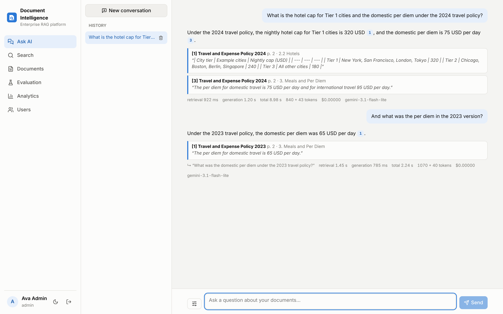
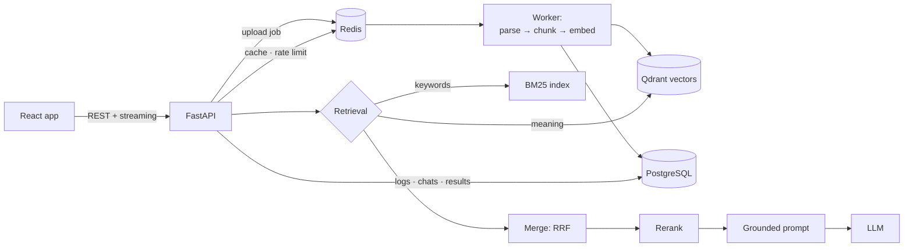
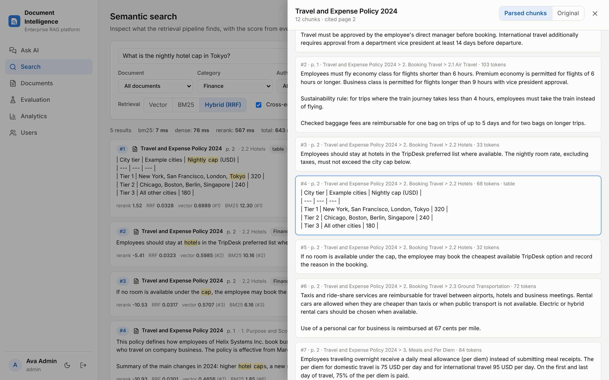
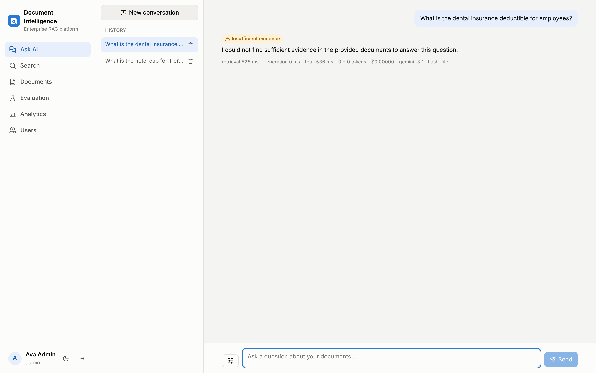
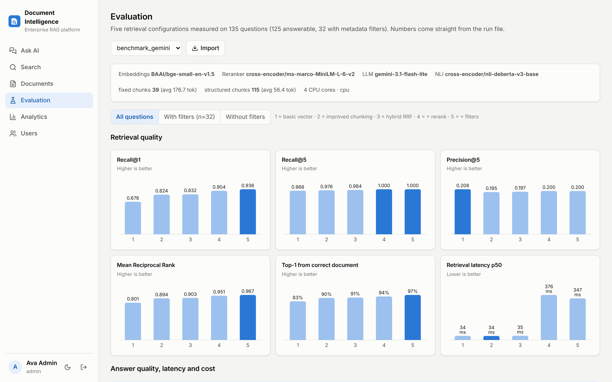

# Enterprise Document Intelligence

**Ask questions about your documents in plain English, and get answers that show exactly where they
came from.**

Upload company documents (PDFs, Word files, text and Markdown), then ask things like *"How many vacation
days do I get?"* or *"Who has to approve a $120,000 purchase?"*. The app finds the right passages, writes a
short answer, and points to the document and page it came from, so you can check it yourself. If the
documents don't contain the answer, it says so instead of guessing.



---

## Contents

1. [What problem does this solve?](#what-problem-does-this-solve)
2. [What can it do?](#what-can-it-do)
3. [How does it work?](#how-does-it-work)
4. [Does it actually work? (measured results)](#does-it-actually-work-measured-results)
5. [Try it yourself](#try-it-yourself)
6. [Choosing the AI model](#choosing-the-ai-model)
7. [For developers](#for-developers)
8. [Screenshots](#screenshots)

---

## What problem does this solve?

Companies have thousands of pages of policies, handbooks, reports and manuals. Finding one fact means
searching through many files, and a general chatbot like ChatGPT doesn't know what's in *your*
documents. It may also confidently make something up.

This project is a **RAG** system (*Retrieval-Augmented Generation*). The idea is simple:

> First **find** the relevant pages in your documents, then let the AI **write an answer using only those
> pages**, and show which pages it used.

It works like an open-book exam: the AI isn't allowed to answer from memory, only from the pages in
front of it, and it must show its sources.

## What can it do?

| Feature | What it means for you |
|---|---|
| 📄 **Upload many documents at once** | PDF, Word (.docx), text and Markdown. Tables, headings and page numbers are kept. |
| 🔁 **Handles duplicates and new versions** | Uploading the same file twice is detected. Uploading a new version replaces the old one. |
| 💬 **Chat with your documents** | Answers appear word by word, like ChatGPT. Follow-up questions ("and in 2023?") work. |
| 📌 **Sources for every answer** | Each answer has numbered references `[1]` that open the exact page and passage. |
| 🚫 **Says "I don't know"** | If the documents don't contain the answer, it refuses instead of inventing one. |
| 🔎 **Smart search** | Understands meaning (*"holiday"* finds *"vacation"*) **and** exact terms (like error code `HX-1201`). |
| 🗂️ **Filters** | Limit a search to a document, category, author or date range, e.g. "only 2024 policies". |
| 📊 **Test results** | A built-in exam of 135 questions measures how accurate the system really is. |
| 📈 **Usage analytics** | Admins see every question asked, response times, cost and errors. |
| 🔐 **Logins and roles** | Viewers can ask questions, editors can upload documents, admins manage everything. |

## How does it work?

### Step 1: Reading documents (when you upload)

```
 Your file  ──►  Read text, tables,  ──►  Cut into small,   ──►  Turn each piece into  ──►  Store them
 (PDF/Word)      headings, pages          sensible pieces        a "meaning fingerprint"     for searching
```

* The app reads each file and keeps its structure: headings, tables and page numbers.
* It cuts the document into small pieces ("chunks"), each about a paragraph or a section. Unlike
  simple tools, it **never cuts a sentence or a table in half** and remembers which chapter each piece
  came from.
* Each piece gets a **"meaning fingerprint"** (an *embedding*), a list of numbers that captures what the
  text is about, so pieces with similar meaning can be found later.
* This happens in the background, so uploading big batches doesn't freeze the app.

### Step 2: Answering a question

```
 Your question
      │
      ├──► Search by MEANING  (finds "holiday" ≈ "vacation")  ─┐
      │                                                        ├──► Merge both lists
      └──► Search by EXACT WORDS (finds "HX-1201")            ─┘          │
                                                                          ▼
                                     A second, more careful AI re-reads the top results
                                     and puts the best ones first ("reranking")
                                                                          │
                                                                          ▼
                     The language model writes a short answer using ONLY those passages,
                     with [1], [2] references, or says "not enough evidence"
```

* **Two kinds of search, combined.** Meaning-based search is good at paraphrases; keyword search is good
  at exact names, numbers and codes. Using both catches more of the right passages.
* **Reranking.** A specialised model re-checks the top ~30 passages against the question and moves
  the truly relevant ones to the top.
* **Safety net.** If even the best passage is clearly unrelated to the question, the app answers
  *"I could not find sufficient evidence…"* **without asking the AI at all**, so the AI gets no chance
  to make something up.

## Does it actually work? (measured results)

We built a test with **13 documents** (policies, a handbook, a financial report, a product spec and more)
and **135 questions** with known correct answers. Ten of the questions are deliberately *not* answerable
from the documents. Then we compared five versions of the system, from the simplest to the full one.

| Version | Right passage ranked **first** | Picked the right **document version** (2023 vs 2024)* | Answer **correct** | Refused the 10 unanswerable questions |
|---|---|---|---|---|
| 1. Basic search (simple chunks, meaning only) | 67.6% | 59.4% | 93.6% | 10 / 10 |
| 2. + Smarter chunking | 82.4% | 81.2% | 93.6% | 10 / 10 |
| 3. + Keyword search combined with meaning | 83.2% | 81.2% | 94.4% | 10 / 10 |
| 4. + Reranking | 90.4% | 87.5% | 95.2% | 10 / 10 |
| **5. + Filters (the full system)** | **93.6%** | **100%** | **96.0%** | **10 / 10** |

\* Measured on the 32 questions where the user narrows the search, e.g. to the 2024 policy.

**In plain words:**

* Every added technique helps. The full system puts the right passage first **93.6%** of the time,
  against **67.6%** for basic search.
* The biggest real-world win is **not mixing up versions**. When there's a 2023 and a 2024 policy with
  different numbers, basic search picked the wrong one 4 times in 10. With filters, it was right every
  time.
* The cited sources contain the supporting evidence about **97%** of the time, and the system refused all
  10 questions the documents couldn't answer.
* Smarter chunking halved the text sent to the AI (1,471 → 765 tokens per question), which halves the cost.

**Honest limits:** the test documents were written for this benchmark, so real-world scores will be
somewhat lower. The full technical report (Recall@K, Precision@K, MRR, faithfulness, citation accuracy,
latency, cost and confidence intervals) is in
[docs/benchmarks/benchmark_gemini.md](docs/benchmarks/benchmark_gemini.md), and how it was measured is
in [docs/EVALUATION.md](docs/EVALUATION.md).

## Try it yourself

You need [Docker Desktop](https://www.docker.com/products/docker-desktop/) installed.

```bash
git clone https://github.com/Manoharreddi2/RAG_Advance.git
```

```bash
cd RAG_Advance
cp backend/.env.example backend/.env
```

```bash
docker compose up --build
```

The first build takes a while because it downloads the AI models. Then:

1. Open **<http://localhost:8080>** and click **Register**. The first account becomes the admin.
2. Go to **Documents** and upload some files. Sample files are in [`backend/eval/corpus/`](backend/eval/corpus/).
3. Wait until their status says **ready**, then go to **Ask AI** and ask a question.
4. Optional: on the **Evaluation** page, click **Import** to see the benchmark results.

To put it online, follow [docs/DEPLOYMENT.md](docs/DEPLOYMENT.md). It includes a one-click setup
for [Render](https://render.com) using [`render.yaml`](render.yaml).

## Choosing the AI model

The app works with several AI providers. Set them in `backend/.env`:

| Option | Cost | Settings |
|---|---|---|
| **Google Gemini** (recommended to start) | Free tier with daily limits | `LLM_PROVIDER=openai_compatible`<br>`OPENAI_BASE_URL=https://generativelanguage.googleapis.com/v1beta/openai/`<br>`OPENAI_API_KEY=<your key from aistudio.google.com>`<br>`OPENAI_MODEL=gemini-3.1-flash-lite`<br>`PRICE_INPUT_PER_M=0` and `PRICE_OUTPUT_PER_M=0` |
| **OpenAI** | Paid (prepaid credits) | `OPENAI_API_KEY=sk-...` (model `gpt-4o-mini` by default) |
| **Ollama** on your own computer | Free, runs locally | `LLM_PROVIDER=openai_compatible`, `OPENAI_BASE_URL=http://localhost:11434/v1`, `OPENAI_MODEL=llama3.1:8b` |
| **Small built-in model** | Free, no key needed, slower and weaker | `LLM_PROVIDER=local` (default when no key is set) |

> Free-tier limits differ per model. `gemini-2.5-flash` allowed only 20 requests a day on a new free key,
> while `gemini-3.1-flash-lite` handled the full 135-question benchmark.

Never commit your `.env` file or paste API keys into code.

---

## For developers

### Technology

| Layer | Tools |
|---|---|
| Frontend | React 18, Vite, TypeScript, Recharts |
| Backend API | Python, FastAPI (async), Server-Sent Events for streaming |
| Document parsing | PyMuPDF (PDF: headings from font sizes, tables, pages), python-docx, Markdown/TXT parsers |
| Search | Qdrant (vector database), own BM25 keyword index, Reciprocal Rank Fusion |
| AI models | `BAAI/bge-small-en-v1.5` (embeddings), `cross-encoder/ms-marco-MiniLM-L-6-v2` (reranking), any OpenAI-compatible LLM |
| Data | PostgreSQL (users, documents, chunks, chats, query logs), Redis (job queue, cache, rate limits) |
| Background jobs | arq worker |
| Ops | Docker, Docker Compose, Render Blueprint, Alembic migrations, GitHub Actions CI |

### Architecture



The full design (components, database schema, API endpoints, folder layout and data flow) is in
[docs/ARCHITECTURE.md](docs/ARCHITECTURE.md). The API reference is in [docs/API.md](docs/API.md), and the
running server serves interactive docs at `http://localhost:8000/docs`.

### Engineering highlights

* **Structure-aware chunking.** Chunks never cross a heading or split a sentence or table row. Each one
  carries its heading path ("Policy > 3. Meals > 3.1 Per diem") as context, and consecutive chunks
  overlap by one sentence.
* **Configurable retrieval.** Every request can choose `dense` / `bm25` / `hybrid`, reranking on or off,
  filters on or off, top-k and candidate depth, so strategies can be compared on live data.
* **Grounded answers.** Answers use numbered passages and mandatory `[n]` citations mapped to document,
  page and quote. Quoted passages are checked against the sources, a fixed refusal is used when evidence
  is missing, and a reranker-score gate refuses before the LLM runs.
* **Performance.** Streaming responses, a Redis answer cache that resets on new uploads, sliding-window
  rate limiting, async I/O, and a query log with retrieved chunks, timings, tokens, cost and errors.
* **One code path.** The API, the tests and the benchmark all use the same retrieval and generation
  code, so the measured numbers describe what actually ships.

### Run without Docker

You need Python 3.12+, Node 22, PostgreSQL 16, Redis 7 and Qdrant
(`docker run -p 6333:6333 qdrant/qdrant:v1.12.4`).

```bash
cd backend
pip install torch --index-url https://download.pytorch.org/whl/cpu
pip install -r requirements-dev.txt
cp .env.example .env
alembic upgrade head
uvicorn app.main:app --reload --port 8000
```

In a second terminal, start the background worker:

```bash
cd backend
arq app.ingestion.worker.WorkerSettings
```

In a third terminal, start the frontend at <http://localhost:5173>:

```bash
cd frontend
npm install
npm run dev
```

Set `INGEST_MODE=inline` to process uploads inside the API instead of running the worker.

### Tests

There are 44 backend tests (unit tests, plus integration tests against real PostgreSQL, Redis, Qdrant and
the real search models) and 3 frontend tests.

```bash
cd backend
pytest tests
```

```bash
cd frontend
npm test
```

### Re-run the benchmark

The first command checks search quality only and takes about 2 minutes. The second also generates and
grades answers with your configured AI model; add `--llm-rpm 14` to stay within free-tier limits.

```bash
cd backend
python -m eval.run --no-generation
```

```bash
cd backend
python -m eval.run --llm-rpm 14
```

### Project structure

```
backend/
  app/
    api/          web endpoints: auth, users, documents, search, chat (+streaming), conversations, analytics, eval, health
    core/         security (JWT, passwords), Redis, rate limiting, cache
    db/           database models
    ingestion/    file parsers, chunking, processing pipeline, background worker
    retrieval/    embeddings, reranker, Qdrant, BM25, filters, retrieval pipeline
    generation/   LLM providers, prompts, citations, follow-up rewriting
    services/     answer streaming, query logging
  alembic/        database migrations
  eval/           benchmark documents, 135 questions, metrics, runner, reports, results
  tests/          unit and integration tests
frontend/src/     pages (chat, search, documents, evaluation, analytics, users), components, API client
docs/             architecture, API, deployment, evaluation, benchmark reports, screenshots
```

---

## Screenshots

| | |
|---|---|
|  **Documents**: upload and manage files |  **Search**: results with scores and filters |
|  **Preview**: jump to the exact cited passage |  **Honesty**: refuses when the answer isn't in the documents |
|  **Evaluation**: measured accuracy of each version |  **Analytics**: response times, usage and cost |
|  **Dark mode** |  **Works on mobile** |
