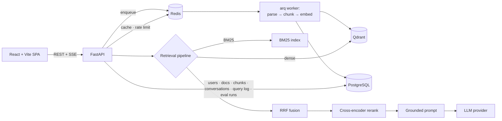
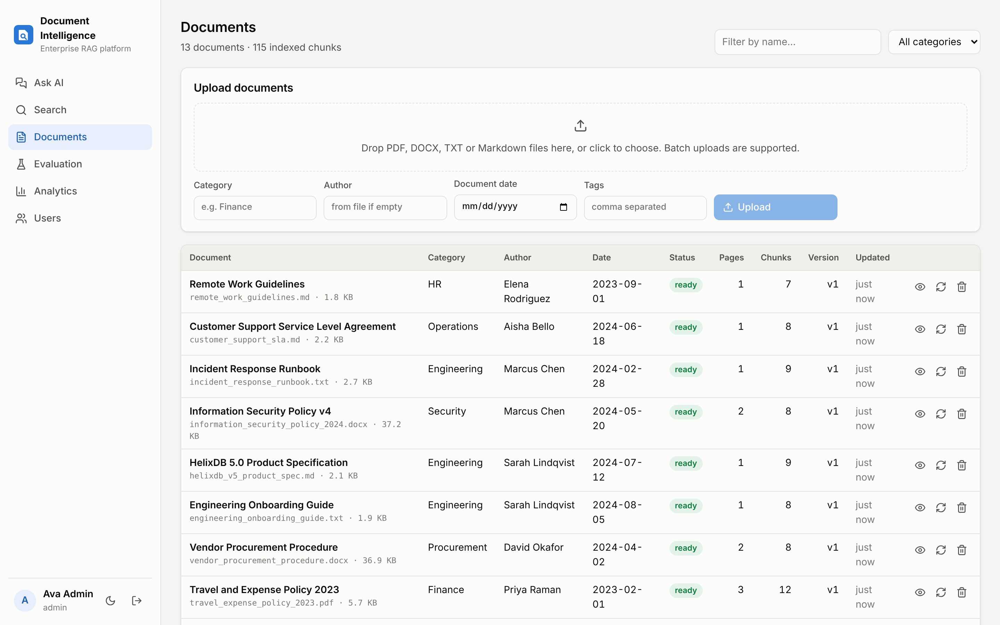
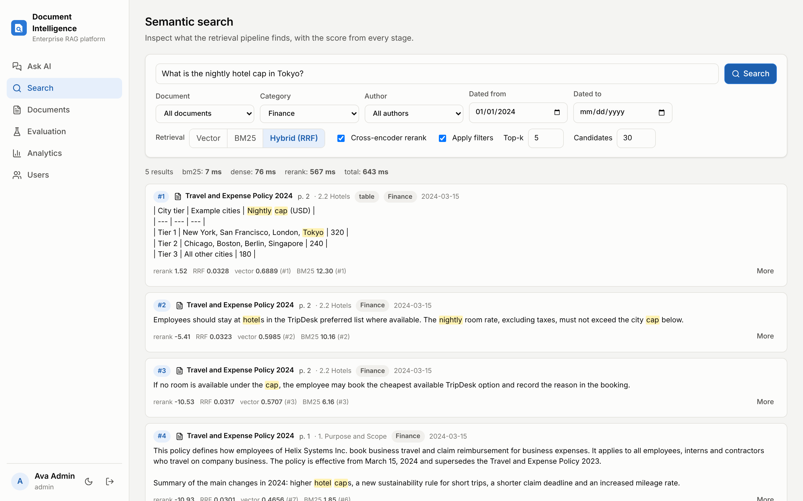
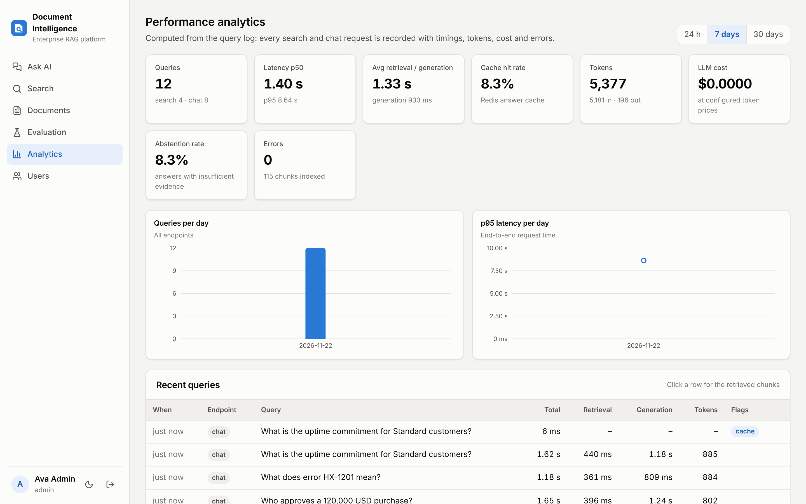
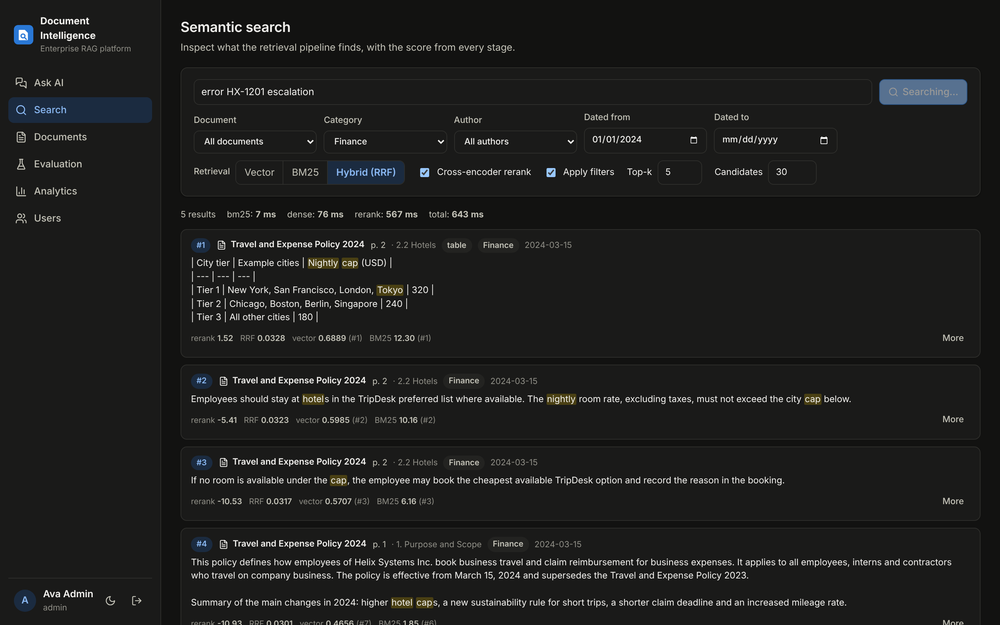
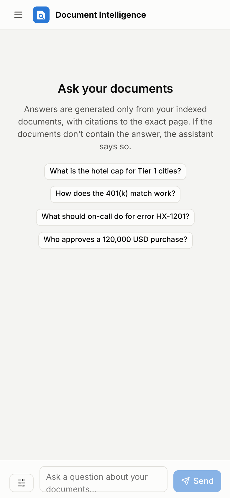

# Enterprise Document Intelligence

A production-grade Retrieval-Augmented Generation platform: ingest large collections of PDF, DOCX, TXT and
Markdown documents, search them with a hybrid retrieval pipeline, and get grounded, cited answers in a
streaming chat — with a built-in evaluation suite that measures what each retrieval technique actually buys.


## Highlights

* **Ingestion** — PDF (PyMuPDF: font-statistics heading detection, table extraction, page numbers), DOCX
  (styles, native tables, page breaks), Markdown and TXT. **Structure-aware chunking** that never crosses a
  heading, never splits a sentence or table row, carries the heading path as context and overlaps by
  sentence. SHA-256 **duplicate detection**, **versioned updates** (same filename → new version, old chunks
  replaced), **batch upload**, and **asynchronous processing** on an arq/Redis worker.
* **Hybrid retrieval** — dense search in **Qdrant** (`BAAI/bge-small-en-v1.5`) + **BM25** (own vectorised
  inverted index), fused with **Reciprocal Rank Fusion**, re-scored by a **cross-encoder**
  (`ms-marco-MiniLM-L-6-v2`), with **metadata filters** (document, category, author, date range) applied
  inside both retrievers. Every stage is switchable per request, so approaches can be compared live.
* **Grounded generation** — numbered context passages, mandatory `[n]` citations mapped to document, page
  and supporting quote, verification of quoted passages, a fixed refusal when evidence is missing and a
  reranker-score **relevance gate** that refuses before the LLM can improvise. Conversational follow-ups
  are rewritten into standalone queries.
* **LLM-agnostic** — OpenAI, any OpenAI-compatible server (Ollama, vLLM, LM Studio, TGI) or a Hugging Face
  model in-process. Chosen automatically from the environment.
* **Performance & operations** — Server-Sent Events streaming, Redis answer cache (invalidated on
  ingestion), Redis sliding-window rate limiting, async I/O throughout, JSON structured logs with request
  ids, and a **query log** of every request (retrieved chunks and scores, timings, tokens, cost, errors)
  that powers the analytics dashboard.
* **Evaluation** — 135-question benchmark with verified evidence spans and gold pages; Recall@K,
  Precision@K, MRR, answer correctness, NLI faithfulness, citation accuracy, latency and cost; five
  configurations compared with bootstrap confidence intervals; Markdown reports and an interactive dashboard.
* **Production readiness** — JWT auth with viewer/editor/admin roles, Alembic migrations, health/readiness
  probes, Dockerfiles, Docker Compose, a Render Blueprint, CI, 44 backend unit + integration tests and
  frontend tests, OpenAPI docs.

## Measured results

<!-- RESULTS -->

## Architecture



Full design — components, database schema, API surface, folder structure and data flow — is in
[docs/ARCHITECTURE.md](docs/ARCHITECTURE.md).

## Quick start (Docker Compose)

```bash
cp backend/.env.example backend/.env        # optionally set OPENAI_API_KEY
docker compose up --build
```

Open <http://localhost:8080>, register (the first account is the admin), upload documents on the
**Documents** page and ask questions on **Ask AI**. API docs: <http://localhost:8000/docs>.

To load the benchmark corpus: upload everything in `backend/eval/corpus/` (or use the script under
*Local development*), then press **Import** on the **Evaluation** page to load the committed results.

## Local development

Prerequisites: Python 3.12+, Node 22, PostgreSQL 16, Redis 7 and Qdrant (`docker run -p 6333:6333 qdrant/qdrant:v1.12.4`).

```bash
cd backend
pip install torch --index-url https://download.pytorch.org/whl/cpu
pip install -r requirements-dev.txt
cp .env.example .env
alembic upgrade head
uvicorn app.main:app --reload --port 8000
```

```bash
cd backend
arq app.ingestion.worker.WorkerSettings
```

```bash
cd frontend
npm install
npm run dev
```

The Vite dev server (<http://localhost:5173>) proxies `/api` to port 8000. Set `INGEST_MODE=inline` to
process uploads inside the API process instead of running the worker.

### LLM configuration

| Setup | Environment |
|---|---|
| OpenAI | `OPENAI_API_KEY=sk-…` (`OPENAI_MODEL`, default `gpt-4o-mini`) |
| Ollama / vLLM / LM Studio | `LLM_PROVIDER=openai_compatible OPENAI_BASE_URL=http://host:11434/v1 OPENAI_MODEL=llama3.1:8b` |
| Local Hugging Face model | `LLM_PROVIDER=local LOCAL_LLM_MODEL=Qwen/Qwen2.5-1.5B-Instruct` (`DEVICE=cuda` on GPU) |

All settings are environment variables; see [`backend/.env.example`](backend/.env.example).

## Tests

```bash
cd backend
pytest tests --ignore=tests/integration
pytest tests/integration
```

```bash
cd frontend
npm test
```

The integration suite runs the full API against real PostgreSQL (migrated with Alembic), Redis, embedded
Qdrant and the real embedding and reranking models: auth and roles, batch upload, async ingestion,
duplicate detection, versioning, all search modes, filters selecting the right document version, chat with
citations, follow-up rewriting, conversation isolation, caching, SSE streaming, the relevance gate,
analytics, rate limiting and deletion. Only the LLM is replaced by a deterministic test double.

## Evaluation

```bash
cd backend
python -m eval.run --no-generation
python -m eval.run
```

The first command computes retrieval metrics only (~2 minutes on CPU); the second also generates and
scores answers with the configured LLM. See [docs/EVALUATION.md](docs/EVALUATION.md) for the dataset,
metric definitions and limitations, and [docs/benchmarks/](docs/benchmarks/) for the generated reports.

## Deployment

[docs/DEPLOYMENT.md](docs/DEPLOYMENT.md) covers Docker Compose, Render (Blueprint in
[`render.yaml`](render.yaml)) and a production checklist.

## Project structure

```
backend/
  app/
    api/          routers: auth, users, documents, search, chat (+SSE), conversations, analytics, eval, health
    core/         security (JWT, bcrypt), Redis, rate limiting, cache
    db/           SQLAlchemy models and async session
    ingestion/    parsers (pdf, docx, text), chunking, pipeline, arq worker
    retrieval/    embeddings/reranker, Qdrant store, BM25, filters, configurable pipeline
    generation/   LLM providers, prompts, citation/quote post-processing, follow-up rewriting
    services/     RAG answer stream, query logging
  alembic/        migrations
  eval/           corpus sources, built corpus, question dataset, metrics, runner, report, results
  tests/          unit and integration tests
frontend/src/     pages (chat, search, documents, evaluation, analytics, users), components, API client
docs/             architecture, API, deployment, evaluation, benchmark reports, screenshots, openapi.json
```

## Screenshots

| | |
|---|---|
|  Document management |  Hybrid search with per-stage scores and filters |
|  Document preview at the cited chunk |  Refusing when the documents lack evidence |
|  Evaluation dashboard |  Performance analytics from the query log |
|  Dark mode |  Responsive layout |
