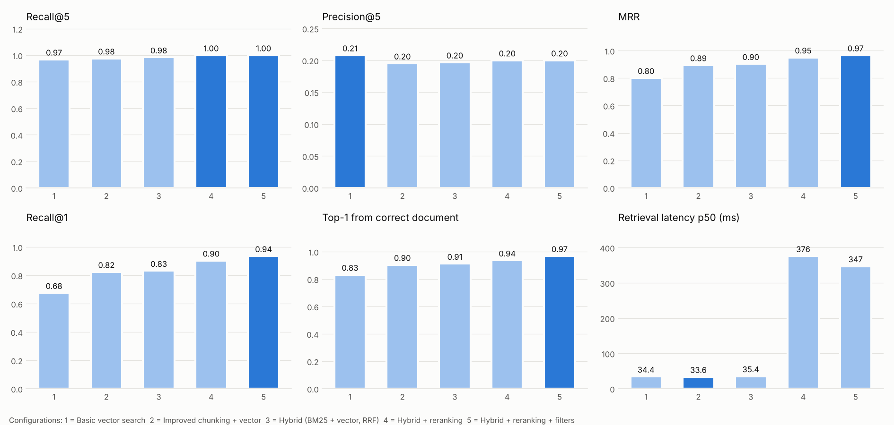
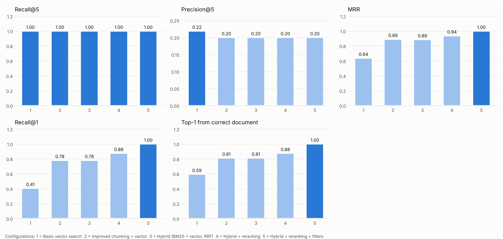

# Benchmark report — `benchmark_gemini`

Generated 2026-11-22T09:43:43.288286+00:00 by `python -m eval.run`. Every number below is computed from `backend/eval/results/benchmark_gemini.json`; nothing was edited by hand.

## Setup

* Questions: **135** (125 answerable, 10 unanswerable, 32 with user-supplied metadata filters)
* Embeddings `BAAI/bge-small-en-v1.5` · reranker `cross-encoder/ms-marco-MiniLM-L-6-v2` · faithfulness NLI `cross-encoder/nli-deberta-v3-base`
* LLM: `gemini-3.1-flash-lite` (openai_compatible) on cpu with 4 CPU cores
* Context passages given to the LLM: 5; retrieval depth 10; abstention gate: best reranker score < -4.0
* Index: `fixed` chunking → 39 chunks (avg 176.7 tokens); `structured` chunking → 115 chunks (avg 56.4 tokens)

## Retrieval (all answerable questions)

| Configuration | Recall@1 | Recall@3 | Recall@5 (95% CI) | Recall@10 | Precision@5 | MRR (95% CI) | Top-1 correct doc | p50 ms | p95 ms |
|---|---|---|---|---|---|---|---|---|---|
| 1. Basic vector search | 0.676 | 0.936 | 0.968 (0.94–0.99) | 0.976 | 0.208 | 0.801 (0.75–0.86) | 0.832 | 34.4 | 43.9 |
| 2. Improved chunking + vector | 0.824 | 0.952 | 0.976 (0.94–1.00) | 0.992 | 0.195 | 0.894 (0.85–0.93) | 0.904 | 33.6 | 43.7 |
| 3. Hybrid (BM25 + vector, RRF) | 0.832 | 0.968 | 0.984 (0.96–1.00) | 1.000 | 0.197 | 0.903 (0.86–0.94) | 0.912 | 35.4 | 48.7 |
| 4. Hybrid + reranking | 0.904 | 1.000 | 1.000 (1.00–1.00) | 1.000 | 0.200 | 0.951 (0.92–0.97) | 0.936 | 376.1 | 487.5 |
| 5. Hybrid + reranking + filters | 0.936 | 1.000 | 1.000 (1.00–1.00) | 1.000 | 0.200 | 0.967 (0.94–0.99) | 0.968 | 347.4 | 462.7 |

### Questions with metadata filters (n = 32)

These are mostly *versioned* questions (e.g. the 2023 vs 2024 travel policy), where an unfiltered search tends to return the wrong version.

| Configuration | Recall@1 | Recall@5 | Precision@5 | MRR | Top-1 correct doc |
|---|---|---|---|---|---|
| 1. Basic vector search | 0.406 | 1.000 | 0.219 | 0.637 | 0.594 |
| 2. Improved chunking + vector | 0.781 | 1.000 | 0.200 | 0.891 | 0.812 |
| 3. Hybrid (BM25 + vector, RRF) | 0.781 | 1.000 | 0.200 | 0.885 | 0.812 |
| 4. Hybrid + reranking | 0.875 | 1.000 | 0.200 | 0.938 | 0.875 |
| 5. Hybrid + reranking + filters | 1.000 | 1.000 | 0.200 | 1.000 | 1.000 |

### MRR by question type

| Configuration | factual (n=66) | followup (n=4) | keyword (n=7) | numeric (n=8) | paraphrase (n=3) | table (n=12) | versioned (n=25) |
|---|---|---|---|---|---|---|---|
| 1. Basic vector search | 0.835 | 0.750 | 1.000 | 0.917 | 0.500 | 0.833 | 0.648 |
| 2. Improved chunking + vector | 0.902 | 1.000 | 1.000 | 0.719 | 1.000 | 0.833 | 0.900 |
| 3. Hybrid (BM25 + vector, RRF) | 0.922 | 1.000 | 1.000 | 0.688 | 1.000 | 0.854 | 0.893 |
| 4. Hybrid + reranking | 0.970 | 1.000 | 1.000 | 0.854 | 1.000 | 0.917 | 0.920 |
| 5. Hybrid + reranking + filters | 0.970 | 1.000 | 1.000 | 0.854 | 1.000 | 0.917 | 1.000 |

> **Latency caveat for this run.** Answers were generated through a free-tier API throttled client-side to 14 requests/minute, and the recorded generation time includes that wait (about 60 / rpm seconds per call). End-to-end latency below is therefore dominated by the throttle and is **not** representative of the system; retrieval latency is unaffected. Runs made with the current runner subtract pacing time automatically.

## Answer quality, latency and cost

| Configuration | Correctness (95% CI) | Key-fact recall | Faithfulness | Citation precision | Citation page acc. | Correct refusals | False refusals | p50 latency ms | p95 latency ms | Tokens in/out | Cost/query (actual) | Cost/query (projected) |
|---|---|---|---|---|---|---|---|---|---|---|---|---|
| 1. Basic vector search | 0.936 (0.89–0.98) | 0.949 | 0.914 | 0.967 | 0.984 | 100.0% | 2.4% | 3808 | 5123 | 1471 / 26 | $0.000000 | $0.000200 |
| 2. Improved chunking + vector | 0.936 (0.89–0.98) | 0.949 | 0.943 | 0.980 | 0.984 | 100.0% | 2.4% | 4047 | 5934 | 787 / 26 | $0.000000 | $0.000100 |
| 3. Hybrid (BM25 + vector, RRF) | 0.944 (0.90–0.98) | 0.952 | 0.939 | 0.980 | 0.984 | 100.0% | 1.6% | 4101 | 5068 | 782 / 26 | $0.000000 | $0.000100 |
| 4. Hybrid + reranking | 0.952 (0.91–0.98) | 0.965 | 0.932 | 0.976 | 0.980 | 100.0% | 0.0% | 4057 | 5006 | 768 / 26 | $0.000000 | $0.000100 |
| 5. Hybrid + reranking + filters | 0.960 (0.93–0.99) | 0.968 | 0.924 | 0.968 | 0.980 | 100.0% | 0.0% | 4025 | 5001 | 765 / 25 | $0.000000 | $0.000100 |

*Actual* cost uses the configured price of the model that ran ($0.0/1M input, $0.0/1M output; $0 for local models and free tiers). *Projected* cost applies a reference API price ($0.15/1M input, $0.6/1M output — gpt-4o-mini list pricing by default, set `PROJECTED_PRICE_INPUT_PER_M`/`PROJECTED_PRICE_OUTPUT_PER_M`) to the token counts measured in this run, so it is an estimate.

## Metric definitions

* **Relevant chunk**: from the gold document and contains ≥70% of a gold evidence span's content tokens (chunking-agnostic, so fixed and structured chunks are judged against the same evidence).
* **Recall@K**: share of a question's gold evidence spans covered by the top-K chunks. **Precision@K**: share of the top-K chunks that are relevant. **MRR**: 1/rank of the first relevant chunk.
* **Answer correctness**: all key facts of the reference answer appear in the generated answer (numbers normalized); unanswerable questions count as correct only when the system refuses.
* **Faithfulness**: share of answer sentences entailed (p ≥ 0.5) by the retrieved passages, judged by the NLI cross-encoder over 1–3-sentence windows of each passage (with its title/date/page header). It is a conservative lower bound: NLI models under-score facts read from table rows and sentences that combine two facts, so some correctly grounded sentences count as unsupported (see per-question results).
* **Citation precision**: share of cited passages `[n]` that contain gold evidence. **Citation page accuracy**: share of cited passages whose document and page range contain a gold page.
* **Latency**: measured wall-clock retrieval + generation for each query on this machine. When two configurations retrieve the identical top-5 for a question, the generation is computed once and its measured time is reused.

## Limitations

* The corpus is a purpose-built synthetic set of 13 enterprise documents (fictional company), written for this benchmark with exact evidence spans; absolute numbers will differ on real corpora.
* Metadata filters in configuration 5 are the filters a user would set in the UI (stored per question); they are not inferred automatically from the question text.
* Answer correctness uses key-fact matching, which can miss correct paraphrases of a fact.
